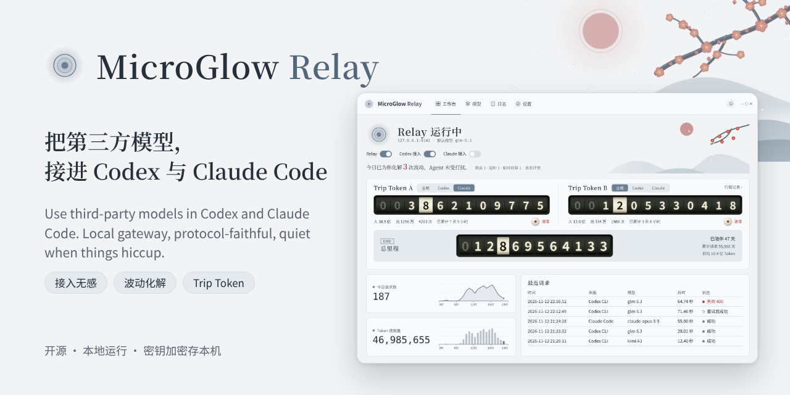
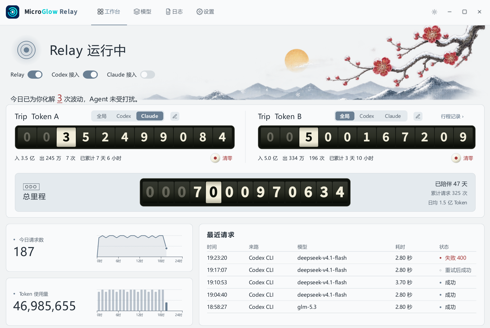
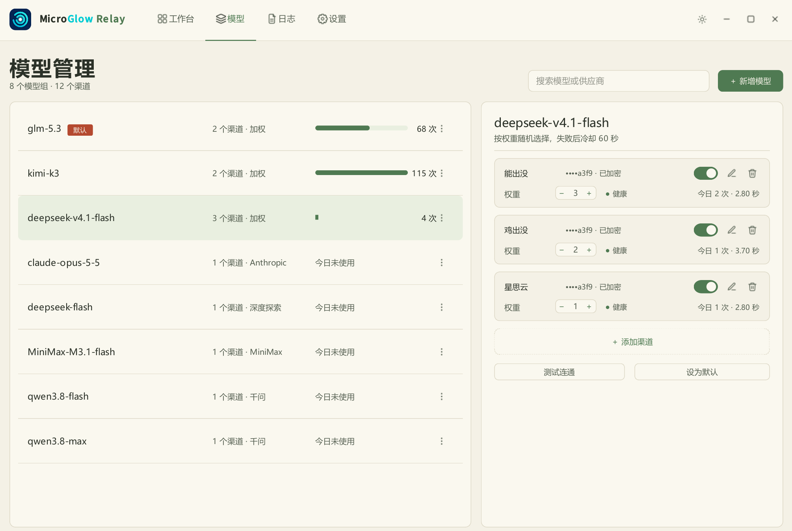
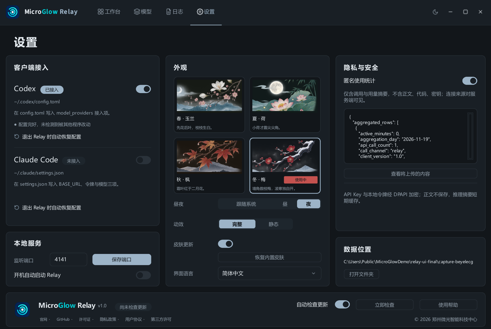
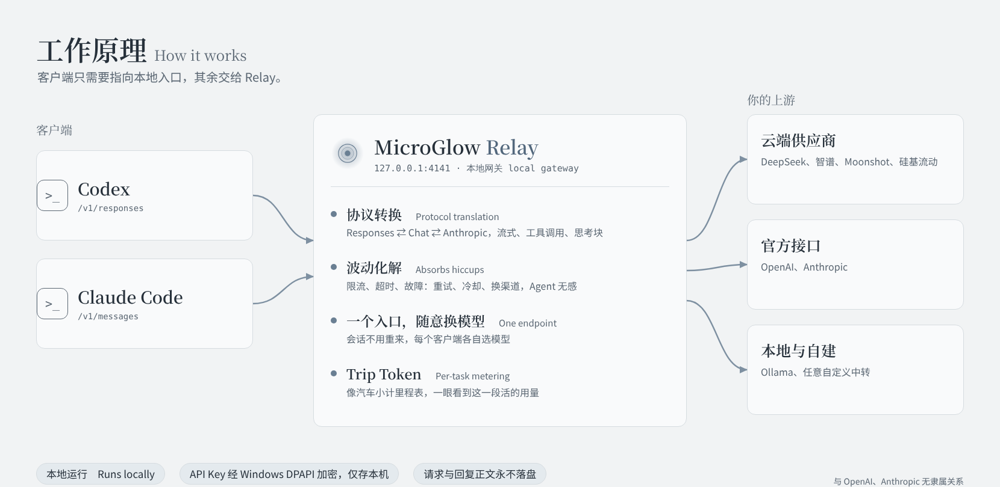
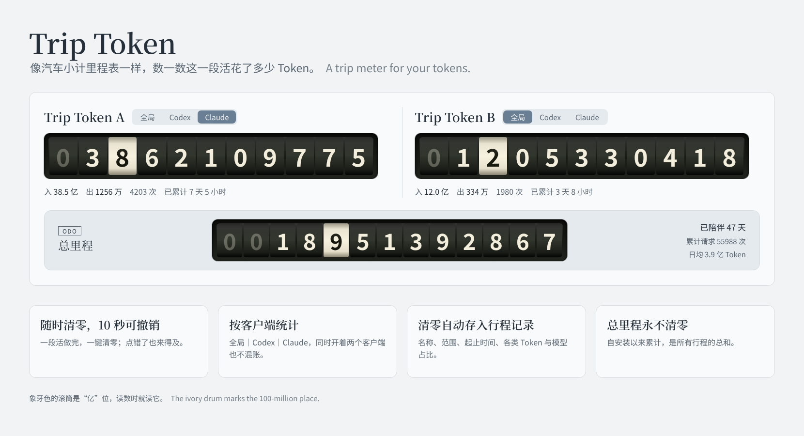

# MicroGlow Relay

**Use third-party models in Codex and Claude Code.**

Documentation site: https://mazda6hk-coder.github.io/MicroGlow-Relay/

**[**Download Relay 1.3 for Windows**](https://github.com/mazda6hk-coder/MicroGlow-Relay/releases/tag/v1.3)
· [Source](#from-source) · [Docs](https://mazda6hk-coder.github.io/MicroGlow-Relay/)**
<sub>Unsigned installer: Windows may show a SmartScreen warning. Verify the SHA-256 on the
[release page](https://github.com/mazda6hk-coder/MicroGlow-Relay/releases/tag/v1.3).</sub>

A local AI model gateway for Windows. Relay listens on `127.0.0.1:4141` and lets
Codex (OpenAI Responses) and Claude Code (Anthropic Messages) reach third-party
model providers through one local endpoint — protocol-faithful, with retries and
channel failover handled quietly.

[](#platform-and-requirements)
[](LICENSE)
[](#interface)
[](CHANGELOG.md)




## Why Relay

**Integration that stays out of the way.** One switch writes the Codex and
Claude Code configuration for you, keeps a backup, detects changes made outside
Relay, and restores the client when you exit. You do not edit
`~/.codex/config.toml` or `~/.claude/settings.json` by hand.

**Hiccups absorbed.** Each channel is retried before the response starts (up to
two attempts; three for HTTP 500). When a channel fails, it is cooled down for
60 seconds and Relay can switch to another channel — weighted at random — as
long as nothing has been sent to the client yet. A stream that has already
started is never replayed.

**Trip Token.** Two independent subtotals, like the trip meters in a car. Each
is scoped to All / Codex / Claude, can be named, can be reset with a 10-second
undo, and is written to a trip ledger when reset. The total odometer never
resets.

## Install

Download the installer from the
[Releases page](https://github.com/mazda6hk-coder/MicroGlow-Relay/releases/tag/v1.3),
or install it with the Windows Package Manager:

```powershell
winget install MicroGlow.MicroGlowRelay
```

The installer is not code-signed, so Windows may show a SmartScreen prompt.
Verify the download against
[SHA256SUMS.txt](https://github.com/mazda6hk-coder/MicroGlow-Relay/releases/download/v1.3/SHA256SUMS.txt).

## Quick start

1. **Install and start Relay.** The Windows installer installs to
   `C:\Program Files\MicroGlow Relay` and requires administrator rights. The
   portable build can be run from any folder.
2. **Add a provider and models.** Open **Models**, enter the provider's base URL
   and API key, then add one or more model names. First install has no preset
   models.
3. **Turn on the client integration.** In **Clients / Setup**, enable Codex
   and/or Claude Code, then restart the client. Relay writes the configuration
   and the client starts using `http://127.0.0.1:4141`.

Quit Relay from the tray menu (not by closing the window) so the client
configuration is restored on exit.

## Screenshots

| Workbench (winter, day) | Models (spring, day) | Settings (winter, night) |
|---|---|---|
|  |  |  |

All numbers, provider names and keys in these screenshots are demo data.

## How it works

<picture>
  <source media="(prefers-color-scheme: dark)" srcset="docs/images/how-it-works-dark.png">
  
</picture>

**Inbound protocols**

| Endpoint | Purpose |
|---|---|
| `POST /v1/responses` | OpenAI Responses (used by Codex) |
| `POST /v1/messages` | Anthropic Messages (used by Claude Code) |
| `POST /v1/messages/count_tokens` | Local token estimate, no upstream call |
| `GET /v1/models` | Configured models |
| `GET /health` | Liveness and version, no token required |

**Upstream protocols:** OpenAI Chat Completions, OpenAI Responses, and
Anthropic Messages. Providers such as DeepSeek, Zhipu, Moonshot, SiliconFlow,
Ollama, OpenAI, Anthropic, and custom relays can be configured.

**Faithful where it matters:** streaming, tool calls (including parallel tool
calls), reasoning/thinking blocks, image input, and prompt-caching fields are
passed through or translated per upstream. Token counting for
`count_tokens` is a local estimate (`JSON characters / 4`), not the provider's
count.

## Trip Token

<picture>
  <source media="(prefers-color-scheme: dark)" srcset="docs/images/trip-token-dark.png">
  
</picture>

- **A and B** are two independent subtotals. Each keeps its own scope
  (All / Codex / Claude); switching the scope changes the view, not the data.
- Timing starts at the first request after a reset, not at the moment you press
  reset. With no requests yet, the display reads "not started".
- **Reset** clears only that subtotal and can be undone for 10 seconds. If the
  subtotal was non-zero, the reset is written to the trip ledger with its name,
  scope, start/end time, tokens, request count and per-model breakdown.
- **The total odometer never resets.** It is the all-time aggregate and is not
  affected by resetting A or B.

All numbers in the screenshots are demo data.

## Privacy and security

- **No account.** Relay runs locally; settings and usage data stay on this
  machine.
- **Credentials.** In Relay's own settings, API keys and the local access token
  are encrypted with Windows DPAPI. To make Codex and Claude Code connect, the
  local access token is written in plain text into those clients' configuration
  files — their formats require a literal token.
- **Request and response bodies are not stored.** The local usage log keeps
  metadata: timestamp, provider, model, status, elapsed time, input/output and
  cached token counts, channel index, and a redacted upstream error excerpt
  (truncated to 800 characters).
- **Reasoning text is cached locally** to support multi-turn continuation of
  tool-call turns: the reasoning text returned by the upstream is kept for up to 7
  days (maximum 2000 entries). This cache stays on this machine and is never
  included in anonymous statistics.
- **Local access.** The gateway binds to `127.0.0.1` only, requires
  `Authorization: Bearer <token>` on every endpoint except `/health`, and rejects
  requests that carry an `Origin` header.
- **Anonymous statistics are opt-in and off by default.** If you opt in, Relay
  uploads one aggregate batch per day on normal exit. Batches contain counts and
  token totals per provider/model — no prompt, response, endpoint URL, file or
  key. The client does not send an IP field or a country code. A network
  connection necessarily exposes the source address to the receiver; the
  telemetry server uses it transiently to infer a country and does not store the
  raw IP as a statistics field.
- **Update checks are on by default.** Relay checks shortly after start and then
  at most once per local day, against the GitHub release API with a fallback to
  the project website. Update requests carry no installation ID, model
  configuration, credentials, conversation content or usage statistics. A new
  version is downloaded and checksum-verified automatically; installation
  always requires your action. Update checks are independent of the statistics
  consent.
- **The installer is not code-signed.** Windows SmartScreen may warn. Compare
  the SHA-256 published with each release.

Full texts: [Privacy policy](docs/PRIVACY-POLICY.md),
[User agreement](docs/USER-AGREEMENT.md).

## Platform and requirements

- **Windows x64.** The installer is 64-bit and requires administrator rights;
  it installs under `C:\Program Files\MicroGlow Relay`. The application uses
  Qt 6.11, which requires Windows 10 or later.
- **8 interface languages:** 简体中文, 繁體中文, English, Deutsch, 日本語, ไทย,
  Español, 한국어. The installer itself is English/Simplified Chinese only.
- **8 skins:** spring / summer / autumn / winter, each with a day and a night
  palette. Default is spring, day.
- **Linux (preview).** A `.deb` and a standalone ELF build are published with
  each release. They are preview builds: not yet covered by full regression
  testing, and they require an unlocked system keyring (Secret Service) to store
  API keys. The source tree in this repository is the Windows application; the
  Linux build is produced from a separate tree that is not yet published here.

## Build from source

Requirements: Windows, Python 3.11 or later.

```powershell
python -m venv work\venv
work\venv\Scripts\python.exe -m pip install -r requirements.txt -r requirements-app.txt
work\venv\Scripts\python.exe runapp.py
```

Smoke test, unit tests, then packaging:

```powershell
work\venv\Scripts\python.exe runapp.py --smoke-test --data-dir work\smoke-data
work\venv\Scripts\python.exe -m unittest discover -s tests -v
.\build-app.ps1
```

`build-app.ps1` builds a PyInstaller onefile executable named after
`VERSION` in `src/storage.py` (the single version source). The installer script
`build-installer.ps1` requires Inno Setup 6.

Note: the core gateway, routing, trip and update tests run headless. UI tests
instantiate Qt and need a desktop session; in a headless environment the suite
may terminate inside Qt.

## FAQ

**Does Relay provide models or an API key?**
No. You bring your own provider account or local model.

**Do I need an account or a subscription?**
Relay has no account of its own. It connects to the endpoints you configure; your
use of those providers remains subject to their terms.

**Why is there no model on first launch?**
There are no presets. Add at least one provider and model on the Models page.

**Requests fail — what do I check?**
Base URL, API key, balance, and the exact model name. For Claude Code-style
entry points, the base URL must be the host root, without `/v1`.

**Where is my data?**
The installed build uses `%LOCALAPPDATA%\MicroGlow Relay\data`. Running from
source uses `data` in the project folder; `--data-dir` overrides it.

**Why does Windows warn about the installer?**
It is not code-signed yet. Verify the published checksum.

**Is Linux supported?**
A preview `.deb` and ELF build are published with each release. They are not yet
regression-tested to the same standard as Windows, and they need an unlocked
Secret Service keyring. The source published here is the Windows tree; the Linux
tree is not yet in this repository.

## Roadmap

Planned, not released. Listed here so that nobody mistakes a plan for a feature:

- Cross-model session continuation.
- Linux regression testing, and publishing the Linux source tree in this repository.
- Code signing for the installer.
- A packaging review for LGPL obligations (see `THIRD_PARTY_NOTICES.md`).

## License, trademarks and artwork

- Source code: **Apache License 2.0** — [LICENSE](LICENSE), [NOTICE](NOTICE).
- Seasonal illustrations, skin artwork, icons and marketing images:
  **CC BY-NC-ND 4.0**, separately from the code — [ARTWORK-LICENSE.md](ARTWORK-LICENSE.md).
- Names and logos are not licensed — [TRADEMARKS.md](TRADEMARKS.md).
- Third-party components: [THIRD_PARTY_NOTICES.md](THIRD_PARTY_NOTICES.md).

MicroGlow Relay is independent and is not affiliated with, endorsed by, or
sponsored by OpenAI or Anthropic. "Codex" and "Claude Code" are used only to
describe client compatibility; no official logos are used.

## Support this project

If Relay is useful to you, a star helps other developers find it. For anything
that does not work, [open an issue](https://github.com/mazda6hk-coder/MicroGlow-Relay/issues)
— bug reports and questions are both welcome. Please remove API keys and
conversation content from anything you paste.

Questions about privacy, or a vulnerability you found, please use the addresses
in [SECURITY.md](SECURITY.md) and the [privacy policy](docs/PRIVACY-POLICY.md).

## Contact

- Support: <support@microglow.com.cn>
- Privacy: <privacy@microglow.com.cn>
- Security: <security@microglow.com.cn> (see [SECURITY.md](SECURITY.md))
- Website: <https://www.microglow.com.cn/relay>

[简体中文说明](README.zh-CN.md)
