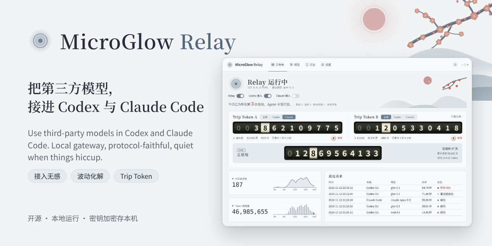
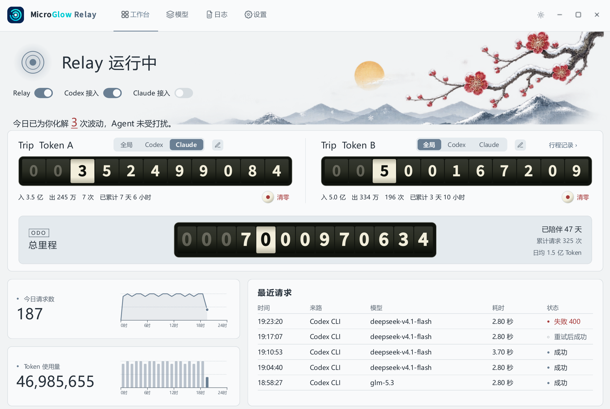
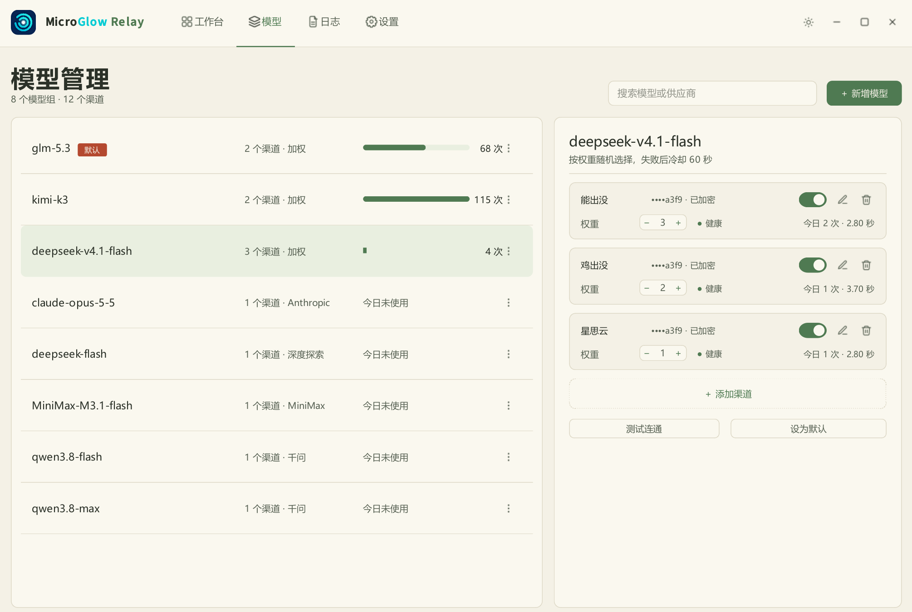
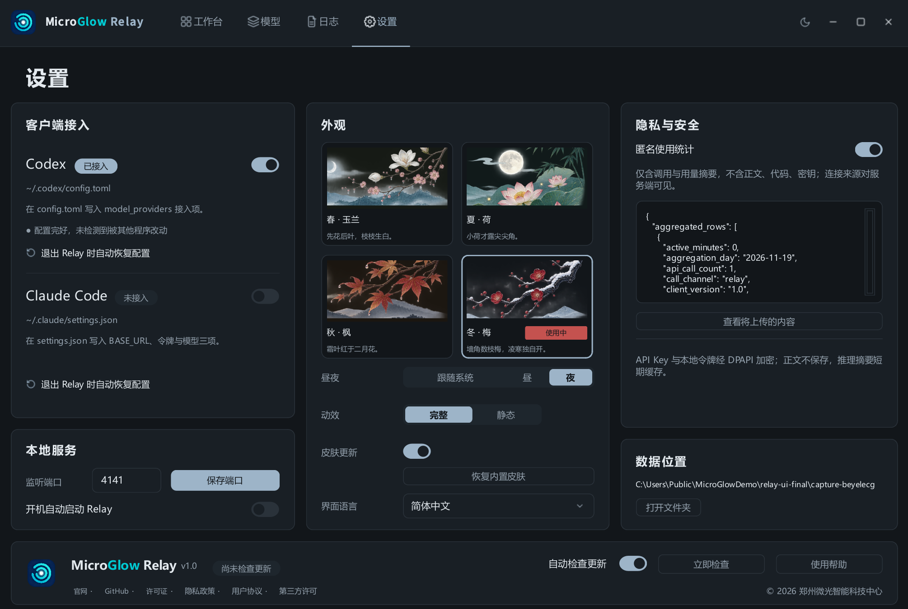
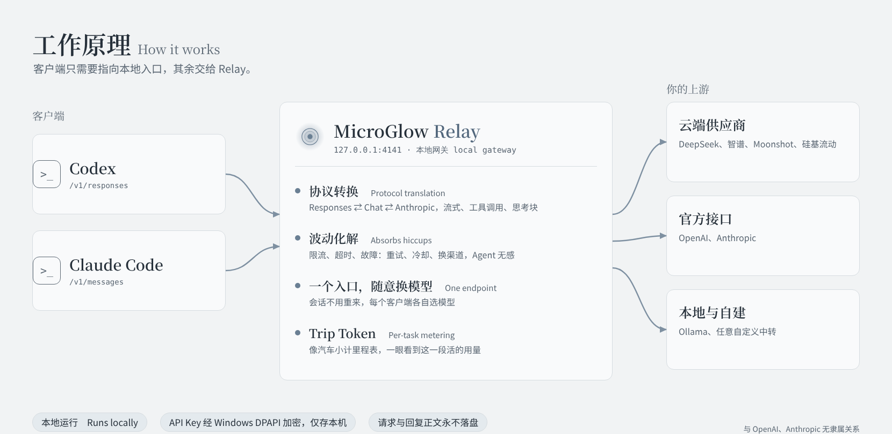
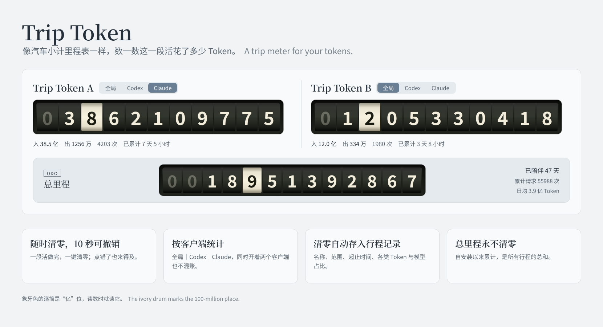

# MicroGlow Relay

**把第三方模型，接进 Codex 与 Claude Code。**

文档站：https://mazda6hk-coder.github.io/MicroGlow-Relay/

面向 Windows 的本地 AI 模型网关。Relay 监听 `127.0.0.1:4141`，让 Codex（OpenAI
Responses）与 Claude Code（Anthropic Messages）通过同一个本地入口使用第三方模型：
协议保真，重试与渠道切换在背后处理，不打扰正在进行的工作。

[](#平台与要求)
[](LICENSE)
[](#界面)
[](CHANGELOG.md)




## 为什么是 Relay

**接入无感。** 一个开关替你写好 Codex 与 Claude Code 的配置，写前留备份，运行中
检测被外部改动，退出时恢复客户端。不需要手工编辑 `~/.codex/config.toml` 或
`~/.claude/settings.json`。

**波动化解。** 响应开始前，每个渠道可重试（最多两次；HTTP 500 最多三次）。渠道
失败后冷却 60 秒，只要还没有向客户端发出内容，Relay 会在剩余渠道里按权重重新选择。
已经开始输出的流绝不重放。

**Trip Token。** 两段独立小计，像汽车上的行程 A / B。每段可选全局、Codex 或 Claude
口径，可命名，清零后 10 秒内可撤销；清零时自动写入行程记录。总里程永不清零。

## 安装

从 [Releases 页面](https://github.com/mazda6hk-coder/MicroGlow-Relay/releases/tag/v1.0)
下载安装包，或用 Windows 包管理器安装：

```powershell
winget install MicroGlow.MicroGlowRelay
```

安装包未做代码签名，Windows 可能显示 SmartScreen 提示。请用
[SHA256SUMS.txt](https://github.com/mazda6hk-coder/MicroGlow-Relay/releases/download/v1.0/SHA256SUMS.txt)
核对校验值。

## 三步上手

1. **安装并启动 Relay。** Windows 安装包安装到 `C:\Program Files\MicroGlow Relay`，
   需要管理员权限；便携版可以放在任意目录运行。
2. **添加供应商与模型。** 打开「模型」页，填入供应商接口地址与 API Key，再添加模型名。
   首次安装没有预置模型。
3. **打开客户端接入。** 在「客户端接入」页开启 Codex 和/或 Claude Code，然后重启客户端。
   Relay 会写好配置，客户端随即指向 `http://127.0.0.1:4141`。

请从托盘菜单退出 Relay（关闭窗口不算退出），这样退出时才会恢复客户端配置。

## 界面截图

| 工作台（冬·昼） | 模型（春·昼） | 设置（冬·夜） |
|---|---|---|
|  |  |  |

截图中的数字、供应商名与密钥均为演示数据。

## 工作原理

<picture>
  <source media="(prefers-color-scheme: dark)" srcset="docs/images/how-it-works-dark.png">
  
</picture>

**入站协议**

| 端点 | 用途 |
|---|---|
| `POST /v1/responses` | OpenAI Responses（Codex 使用） |
| `POST /v1/messages` | Anthropic Messages（Claude Code 使用） |
| `POST /v1/messages/count_tokens` | 本地估算，不请求上游 |
| `GET /v1/models` | 已配置的模型 |
| `GET /health` | 存活与版本，无需令牌 |

**上游协议：** OpenAI Chat Completions、OpenAI Responses、Anthropic Messages。
可配置 DeepSeek、智谱、Moonshot、硅基流动、Ollama、OpenAI、Anthropic 与自定义中转。

**在要紧的地方保真：** 流式、工具调用（含并行）、思考/推理块、图片输入、提示缓存
字段，按上游能力透传或转换。`count_tokens` 是本地估算（JSON 字符数 / 4），不是
供应商的计数。

## Trip Token

<picture>
  <source media="(prefers-color-scheme: dark)" srcset="docs/images/trip-token-dark.png">
  
</picture>

- **A 与 B** 是两段独立小计，各自保存自己的口径（全局 / Codex / Claude）。切换口径
  只换视角，不重算、不丢数。
- 计时从清零后的第一笔调用开始，不是按下清零的瞬间。还没有调用时显示"尚未开始"。
- **清零**只清该段，10 秒内可撤销。该段此前不为零时，清零会写入行程记录，包含名称、
  口径、起止时间、Token、请求次数与按模型拆分。
- **总里程永不清零。** 它是自安装以来的累计，不受 A / B 清零影响。

截图中的数字均为演示数据。

## 隐私与安全

- **不需要账号。** Relay 在本机运行，设置与使用数据留在本机。
- **凭证。** Relay 自身设置里的 API Key 与本地访问令牌使用 Windows DPAPI 加密。
  为了让 Codex 与 Claude Code 连上，本地访问令牌会以明文写入这两个客户端自己的配置
  文件——它们的格式要求字面令牌。
- **请求与回复正文不保存。** 本地使用日志只记录元数据：时间、供应商、模型、状态、
  耗时、输入/输出与缓存 Token 数、渠道序号，以及脱敏并截断到 800 字符的上游错误摘录。
- **推理文本会短期缓存**，用于工具调用轮次的多轮续接：上游返回的推理文本最长保留
  7 天、最多 2000 条。该缓存仅在本机，不随匿名统计上传。
- **本地访问。** 网关只绑定 `127.0.0.1`；除 `/health` 外所有端点都要求
  `Authorization: Bearer <token>`，并拒绝携带 `Origin` 头的请求。
- **匿名统计默认关闭、需明确同意。** 同意后，正常退出时每天上传一次聚合批次。批次
  只含按供应商/模型的计数与 Token 汇总，不含提示词、回复、接口地址、文件或密钥。
  客户端不发送 IP 字段，也不发送国家代码。网络连接必然向接收端暴露来源地址；遥测
  服务端仅用它瞬时推断国家，不把原始 IP 作为统计字段保存。
- **自动检查更新默认开启。** 启动后不久检查一次，此后每个本地自然日最多一次，先请求
  GitHub 发布接口，失败时回退官网清单。更新请求不带安装标识、模型配置、凭证、会话
  内容或使用统计。新版本会自动下载并校验，安装始终需要你操作。更新检查与统计授权
  相互独立。
- **安装包未做代码签名。** Windows 可能显示 SmartScreen 提示，请核对随版本发布的
  SHA-256。

全文：[隐私政策](docs/PRIVACY-POLICY.md)、[用户协议](docs/USER-AGREEMENT.md)。

## 平台与要求 {#平台与要求}

- **Windows x64。** 安装包为 64 位、需要管理员权限，安装到
  `C:\Program Files\MicroGlow Relay`。程序使用 Qt 6.11，要求 Windows 10 或更高版本。
- **8 种界面语言：** 简体中文、繁體中文、English、Deutsch、日本語、ไทย、Español、
  한국어。安装向导本身只有英文与简体中文。
- **8 组皮肤：** 春、夏、秋、冬 × 昼夜。默认春·昼。
- **本版本不支持 Linux。**

## 从源码构建 {#从源码构建}

要求：Windows，Python 3.11 或更高。

```powershell
python -m venv work\venv
work\venv\Scripts\python.exe -m pip install -r requirements.txt -r requirements-app.txt
work\venv\Scripts\python.exe runapp.py
```

冒烟测试、单元测试与打包：

```powershell
work\venv\Scripts\python.exe runapp.py --smoke-test --data-dir work\smoke-data
work\venv\Scripts\python.exe -m unittest discover -s tests -v
.\build-app.ps1
```

`build-app.ps1` 用 PyInstaller onefile 打包，文件名取自 `src/storage.py` 的
`VERSION`（唯一版本源）。`build-installer.ps1` 需要 Inno Setup 6。

注意：网关、路由、Trip 与更新相关的核心测试可在无界面环境运行；UI 测试会创建 Qt
组件，需要桌面会话，在无界面环境中可能在 Qt 内部终止。

## 常见问题

**Relay 提供模型或 API Key 吗？**
不提供。模型来自你自己的供应商账号或本地模型。

**需要账号或订阅吗？**
Relay 本身没有账号。它连接你配置的接口，使用这些服务仍受其各自条款约束。

**首次启动为什么没有模型？**
没有预置。请在「模型」页至少添加一个供应商与模型。

**请求失败要查什么？**
接口地址、API Key、余额与模型名。用于 Claude Code 的入口，Base URL 要填主机根地址，
不要带 `/v1`。

**数据在哪里？**
安装版在 `%LOCALAPPDATA%\MicroGlow Relay\data`；源码运行使用项目内 `data`，
可用 `--data-dir` 指定。

**Windows 为什么提示安装包有风险？**
尚未代码签名。请核对发布的校验值。

**支持 Linux 吗？**
本版本不支持。

## 路线图

以下均为计划，尚未发布；写在这里是为了不让计划被误当成功能：

- 跨模型会话续接。
- Linux 回归测试与发布（通过后才会做）。
- 安装包代码签名。
- LGPL 打包方式的复核（见 `THIRD_PARTY_NOTICES.md`）。

## 许可证、商标与素材

- 源代码：**Apache License 2.0** —— [LICENSE](LICENSE)、[NOTICE](NOTICE)。
- 四季插画、皮肤美术、图标与宣传图：**CC BY-NC-ND 4.0**，与代码分开授权 ——
  [ARTWORK-LICENSE.md](ARTWORK-LICENSE.md)。
- 名称与 Logo 不在许可范围内 —— [TRADEMARKS.md](TRADEMARKS.md)。
- 第三方组件：[THIRD_PARTY_NOTICES.md](THIRD_PARTY_NOTICES.md)。

MicroGlow Relay 是独立项目，与 OpenAI、Anthropic 无隶属、背书或赞助关系。
"Codex" 与 "Claude Code" 仅用于说明客户端兼容性，未使用其官方 Logo。

## 联系方式

- 支持：<support@microglow.com.cn>
- 隐私：<privacy@microglow.com.cn>
- 安全：<security@microglow.com.cn>（见 [SECURITY.md](SECURITY.md)）
- 官网：<https://www.microglow.com.cn/relay>

[English](README.md)
